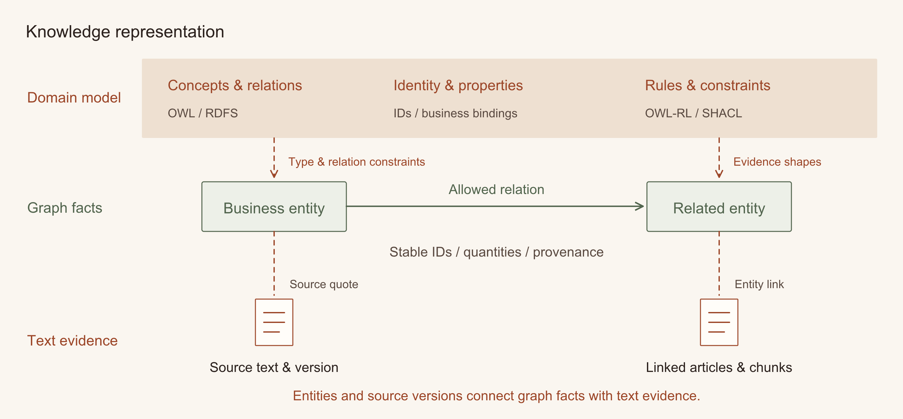
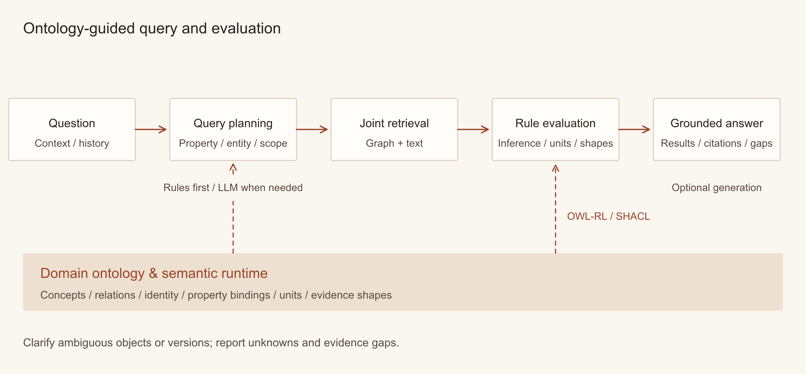
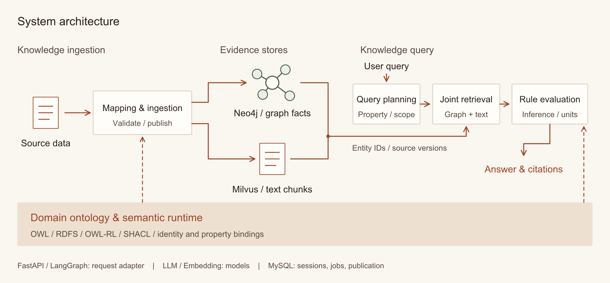

<p align="center">
  
</p>

<h1 align="center">GustoBot · Taotao</h1>

<p align="center"><strong>Enterprise question answering with domain ontologies</strong></p>

<p align="center"><a href="./README.md">简体中文</a> · <strong>English</strong></p>

<p align="center">
  <a href="#features">Features</a> ·
  <a href="#quick-start">Quick start</a> ·
  <a href="#architecture">Architecture</a> ·
  <a href="#documentation">Documentation</a>
</p>

<p align="center">
  <a href="./docs/ARCHITECTURE_FLOW.md"></a>
  <a href="https://docs.langchain.com/oss/python/langchain/overview"></a>
  <a href="https://docs.langchain.com/oss/python/langgraph/overview"></a>
  <a href="https://fastapi.tiangolo.com/"></a>
  <a href="./docs/ONTOLOGY_REUSE.md"></a>
  <a href="https://www.docker.com/"></a>
  <a href="./LICENSE"></a>
</p>

## What is GustoBot?

GustoBot answers questions from a knowledge graph and source documents. A domain ontology defines the concepts, relationships, and rules used in queries. Answers cite the sources used.

The included application lets users browse recipes and ask Taotao about a selected preparation. Recipes with the same name are distinguished by source and version, with ingredients, quantities, steps, and reported durations kept for each preparation.

## Features

### Domain definitions and ingestion

The recipe ontology uses OWL/RDFS to describe concepts and relationships. SHACL checks incoming facts and the graph evidence needed to answer a question. The same definitions specify object identity, query properties, and unit rules.

Structured records are mapped into the graph with source quotations. Articles are split into chunks and published for vector search. They can also be linked to graph objects by entity, source, and version, so an answer can use both.

<p align="center">
  <a href="./docs/assets/architecture/knowledge-representation.png">
    
  </a>
</p>

Documents can remain text-only. To add graph facts from a document, extract candidates, review them, and validate them before writing to the graph. [Data model and ingestion](./docs/DOMAIN_KNOWLEDGE.md)

### Queries, calculations, and answers

To answer a question, the service resolves the relevant objects and source versions, queries properties allowed by the ontology, and reads the selected material and relevant published documents. Simple questions follow rules; a model helps plan queries with more complex conditions.

For supported properties, code applies ontology rules to calculate values and check fact evidence. A model writes explanations from the retrieved material when needed. Ambiguous preparations or versions prompt a clarification, and missing information is reported.

<p align="center">
  <a href="./docs/assets/architecture/knowledge-reasoning.png">
    
  </a>
</p>

Recorded quantities can be converted using unit rules; descriptions such as "to taste" keep their original meaning. Answers about a preparation follow the selected recipe version, with related articles supplying background. [Query rules](./docs/DOMAIN_KNOWLEDGE.md)

### Managing knowledge and conversations

In the admin interface, users can read source documents, publish or withdraw them, delete document records, review candidate facts, and view saved conversations. Chat shows progress and citations. Knowledge updates go through ingestion or review; generated answers are not written back to the graph automatically. [Admin guide](./docs/ADMIN_GUIDE.md)

## Quick start

Install Docker and Docker Compose, then clone the repository and copy the configuration file.

```bash
git clone https://github.com/skygazer42/GustoBot.git
cd GustoBot
cp .env.example .env
```

In Windows PowerShell, copy the file with `Copy-Item .env.example .env`. Configure the following in `.env`:

- **Chat model:** set `LLM_BASE_URL`, `LLM_API_KEY`, and `LLM_MODEL`.
- **Embedding model:** set `EMBEDDING_BASE_URL`, `EMBEDDING_API_KEY`, and `EMBEDDING_MODEL`. Match `EMBEDDING_DIMENSION` to the model's actual output dimension.
- **Storage:** replace `MYSQL_PASSWORD`, `MYSQL_ROOT_PASSWORD`, and `NEO4J_PASSWORD`. Keep the MySQL application credentials in `DATABASE_URL` consistent with these settings. URL-encode reserved characters in the connection string.
- **Admin login:** set `GUSTOBOT_ADMIN_PASSWORD` and a separate, random `SECRET_KEY` of at least 32 bytes.

Chat and embedding models can use separate OpenAI-compatible endpoints. See the [quick-start guide](./docs/QUICK_START.md) for configuration, local development, and data import.

```bash
docker compose --env-file .env up -d --build
```

| Entry point | Default URL |
| --- | --- |
| Recipe interface and Taotao chat | <http://localhost:8000/> |
| Knowledge administration | <http://localhost:8000/admin.html> |
| API documentation | <http://localhost:8000/docs> |
| Health check | <http://localhost:8000/health> |

Ports are configurable. The recipe catalog and knowledge base are prepared separately. See [data preparation](./docs/DATA_SOURCES.md) and the [admin guide](./docs/ADMIN_GUIDE.md) for file locations, images, and import steps.

## Architecture

Ingestion and queries use the same ontology. The query service reads graph facts and text from separate stores.

<p align="center">
  <a href="./docs/assets/architecture/knowledge-overview.png">
    
  </a>
</p>

| Component | Role |
| --- | --- |
| UI and API | Vue renders the pages, FastAPI serves the API, and AG-UI streams progress and replies; LangGraph forwards ordinary chat requests |
| Query service | Reads ontology definitions, builds controlled queries, retrieves material, and calculates and validates results |
| Graph and text | Neo4j stores facts and quotations; Milvus stores vectors for published documents |
| Conversation and publication records | MySQL stores conversations, source versions, ingestion jobs, and publication state |
| Models | LLMs extract candidate facts, plan queries when needed, and write answers; embedding models produce vectors |

[Shared query service](./gustobot/application/services/knowledge_query.py) · [Ingestion service](./gustobot/application/services/knowledge_ingestion.py) · [Semantic runtime](./gustobot/infrastructure/knowledge/semantic_runtime.py) · [Diagrams and detailed flows](./docs/ARCHITECTURE.md)

### Using other domains

The recipe domain loads OWL/RDFS and SHACL files and runs OWL-RL inference. Equipment and generic domains have YAML examples. Adding a domain requires an ontology, field mappings, and query bindings, along with validation. Some query prompts and numeric calculations are still recipe-specific.

Supported ontology constructs and query forms are listed in the [domain guide](./docs/DOMAIN_KNOWLEDGE.md). Source quality, entity matching, and aliases still need domain review; semantic checks do not establish whether an article is true. [Domain profiles](./gustobot/config/domains/)

## Documentation

The detailed guides below are currently in Chinese.

- [Quick start](./docs/QUICK_START.md): model configuration, local development, and data import.
- [Domain knowledge service](./docs/DOMAIN_KNOWLEDGE.md): knowledge representation, query plans, evidence, and API contracts.
- [Ontology reuse](./docs/ONTOLOGY_REUSE.md): the Schema.org subset, vocabulary sources, and mapping rationale.
- [Admin guide](./docs/ADMIN_GUIDE.md): document publication, graph review, query testing, and conversation history.
- [Deployment and upgrades](./docs/DEPLOYMENT.md): storage configuration, upgrades, and operations.
- [Code map](./docs/PROJECT_STRUCTURE.md): entry points and module responsibilities.

## Data and license

The project code is licensed under [Apache License 2.0](./LICENSE). Third-party recipes, documents, and images retain their respective licenses. See [data sources and provenance](./docs/DATA_SOURCES.md) for details.

For bugs and suggestions, open a [GitHub issue](https://github.com/skygazer42/GustoBot/issues).
