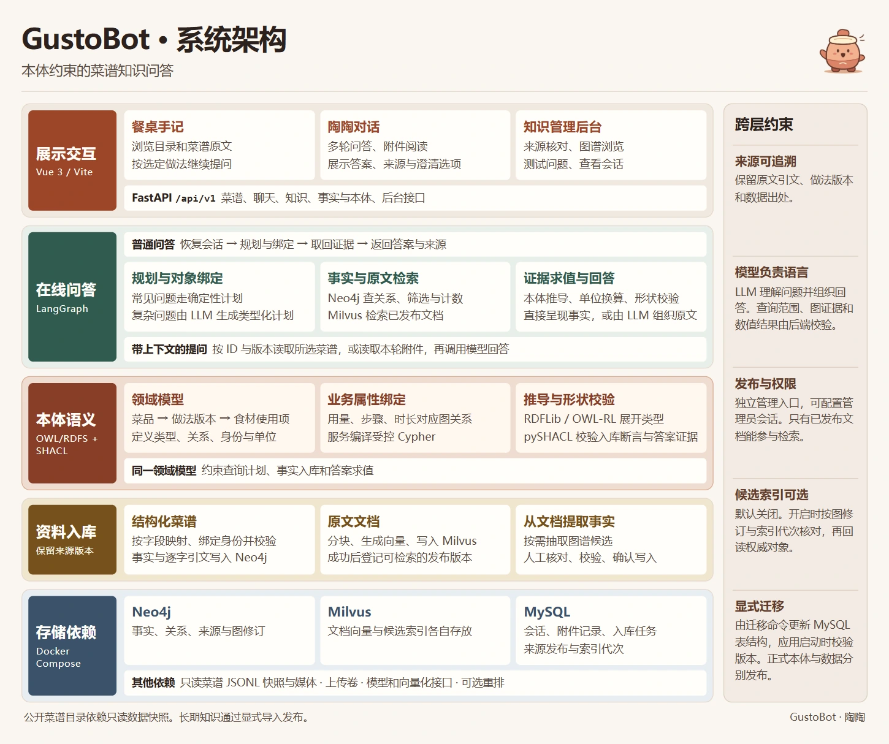

<p align="center">
  
</p>

<h1 align="center">GustoBot · 陶陶</h1>

<p align="center"><strong>基于领域本体的菜谱知识问答系统</strong></p>

<p align="center">
  <a href="#核心能力">核心能力</a> ·
  <a href="#快速开始">快速开始</a> ·
  <a href="#系统架构分析">系统架构</a> ·
  <a href="#开发文档">开发文档</a>
</p>

<p align="center">
  <a href="./docs/ONTOLOGY_REUSE.md"></a>
  <a href="https://www.docker.com/"></a>
  <a href="./LICENSE"></a>
</p>

## 项目简介

同一道菜可以有多份做法。用量和步骤属于具体配方，饮食文化和烹饪背景则来自原文资料。**GustoBot** 用领域本体描述这些关系，把结构化菜谱、知识图谱和已发布文档接入同一套问答服务。陶陶根据查到的证据回答，并附上做法版本或原文出处。

## 核心能力

- **区分同名做法。** 菜品、做法版本和食材使用项分别建模。遇到同名做法时，系统列出带来源的候选，按选定版本继续查询。
- **按领域规则查询和计算。** 通过本体声明的业务属性查询用量、步骤和时长。支持单位换算、条件筛选、排序和计数，保留「适量」等定性描述和缺失状态。
- **结合图谱事实与原文。** 同一个查询计划可以读取 Neo4j 中的事实和 Milvus 中的已发布文档。选择具体菜谱后，回答以当前版本为配方依据，关联的图谱和文章补充背景。
- **显示执行阶段和证据。** Vue 对话界面接收 AG-UI 进度与文本事件，回答完成后展示来源。管理后台提供文档发布、原文核对和图谱候选审核。[管理后台指南](./docs/ADMIN_GUIDE.md)

## 快速开始

使用 Docker Compose 部署。克隆仓库并复制配置模板。

```bash
git clone https://github.com/skygazer42/GustoBot.git
cd GustoBot
cp .env.example .env
```

完成环境配置和资料准备后，启动 GustoBot。[快速启动指南](./docs/QUICK_START.md)

```bash
docker compose --env-file .env up -d --build
```

## 系统架构分析

<p align="center">
  <a href="./docs/assets/gustobot-architecture.webp">
    
  </a>
</p>

### 领域本体

菜谱本体复用 Schema.org 的 `Recipe` 和 `HowToStep` 词汇。做法版本关联步骤和食材使用项，每条投料记录保留角色、原始用量、单位和引文。后端加载版本化的 OWL/RDFS 与 SHACL 文件，通过 OWL-RL 推导类型和属性关系，并编译身份规则、业务属性绑定和证据形状。入库和查询共用这套定义。[菜谱本体](./gustobot/config/ontologies/recipes.ttl) · [SHACL 形状](./gustobot/config/ontologies/recipes.shacl.ttl) · [本体复用说明](./docs/ONTOLOGY_REUSE.md)

### 查询与证据

1. **生成查询计划。** LangGraph 将普通对话交给问答服务。简单查询可以走确定性计划，复杂查询由模型选择本体声明的业务属性与条件。服务解析实体身份和做法版本。
2. **编译并执行检索。** 后端按业务属性的存储绑定生成参数化 Cypher。Neo4j 在完整查询范围内计算筛选、排序和计数，Milvus 按已发布的来源版本检索相关原文。
3. **验证证据并组织回答。** 运行时将图事实投影为 RDF，按领域规则换算数量，再执行与当前对象和属性匹配的 SHACL 证据形状。结构化结果可直接呈现，模型基于取回的证据组织需要归纳的回答。
4. **推送进度和来源。** FastAPI 通过 AG-UI 发出实际执行阶段与生成片段，完整回答落库后随完成事件返回来源。[统一问答服务](./gustobot/application/services/knowledge_query.py) · [查询计划与证据契约](./docs/DOMAIN_KNOWLEDGE.md)

### 入库与存储

结构化菜谱按来源字段映射为图事实，校验后写入 Neo4j。文档先切块并生成向量，写入 Milvus 后登记可检索的来源版本。由文档抽取的图谱候选经人工核对和服务端校验后写入。MySQL 记录会话、入库作业和发布状态。[入库服务](./gustobot/application/services/knowledge_ingestion.py) · [后台管理](./docs/ADMIN_GUIDE.md)

领域定义可独立配置。仓库提供设备与通用领域样板，可复用问答和发布服务，加载对应的领域约束与资料。[领域配置](./gustobot/config/domains/) · [领域知识服务](./docs/DOMAIN_KNOWLEDGE.md)

## 开发文档

- 查询计划、本体约束与 API 契约。[领域知识服务](./docs/DOMAIN_KNOWLEDGE.md)
- 部署配置、存储与升级步骤。[部署与升级](./docs/DEPLOYMENT.md)
- 文档入库、图谱审核与问答测试。[管理后台指南](./docs/ADMIN_GUIDE.md)
- 代码入口与模块职责。[项目代码导航](./docs/PROJECT_STRUCTURE.md)

## 数据与许可证

项目代码采用 Apache License 2.0。第三方菜谱、文档和图片按各自的来源与许可使用。[代码许可证](./LICENSE) · [数据来源与血缘](./docs/DATA_SOURCES.md)

欢迎提交问题和改进建议。[GitHub Issues](https://github.com/skygazer42/GustoBot/issues)
