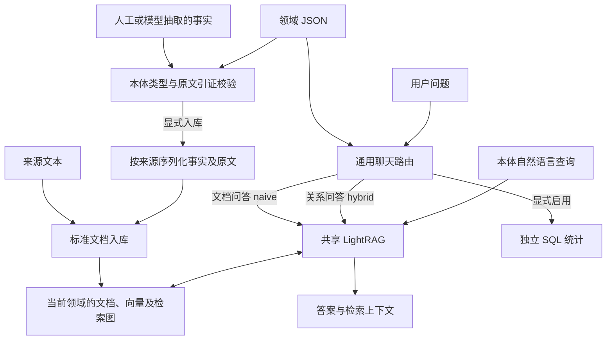

<div align="center">
  
  
  <h3>智能菜谱客服</h3>
  <p>领域可配置的知识问答系统，内置菜谱示例</p>

  
  
  
  
  
  
  
</div>


## 项目简介

GustoBot 是一个领域可配置的知识问答系统。菜谱是内置示例，也可以通过领域 JSON 和自己的资料切换到设备、产品或其他业务领域。

文档问答、关系问答和本体查询统一复用一个 LightRAG 服务及当前领域索引。业务代码不再生成或维护 Cypher，也不再装配独立 Neo4j 问答链路。LangChain 使用 1.x，LightRAG 固定为 `lightrag-hku==1.4.9.8`。

## 当前流程



领域定义约束输入事实的实体、关系、属性和原文引证。已校验事实按来源转为文档，再由 LightRAG 抽取合并到统一索引；抽取与校验接口本身不自动入库。检索图用于回答关系问题，不提供精确有向路径或强类型图数据库保证。

| 能力 | 实现与边界 |
| --- | --- |
| 文档与关系问答 | 共享 LightRAG，按检索模式选择文档或图上下文 |
| 领域配置 | 实体/关系定义、路由关键词、回答范围、独立索引目录 |
| 本体输入校验 | 校验属性、关系端点和逐字引文，保留来源原文与 URI |
| SQL 统计 | 默认关闭，显式配置领域开关及 SQL_DATABASE_URL；schema 来自 SQL 数据库 |
| 对话管理 | SQLite 默认会话持久化及 LangGraph 上下文 |
| 图片与文件 | 按需使用视觉/图像模型；LightRAG 支持文本文件上传 |
| 旧文档 KB | 显式选择 legacy_kb 后保留 pgvector/Milvus 链路 |

完整接口契约、流程图和迁移边界见 [领域知识服务](docs/DOMAIN_KNOWLEDGE.md)。

## 快速开始

需要 Python 3.10–3.13；前端使用 Node.js/npm，也可仅运行后端。

```powershell
Copy-Item .env.example .env
# 编辑 .env，配置实际 LLM 和 Embedding 服务
python -m pip install -r requirements.txt
python -m uvicorn gustobot.main:application --reload
```

另一个终端启动前端：

```powershell
Set-Location web
npm install
npm run dev
```

访问后端 [API 文档](http://localhost:8000/docs)，前端地址以 Vite 输出为准。

容器启动：

```powershell
docker compose up --build
```

默认只启动 backend，使用 SQLite 和本地 LightRAG 索引。已有 `.env` 中的数据库连接不会被覆盖。MySQL、旧 KB 和 Redis 分别通过 `sql`、`legacy-kb`、`legacy-cache` profiles 显式启用；profile 不会自动切换领域配置。

切换领域时设置 `KNOWLEDGE_DOMAIN_FILE=gustobot/config/domains/equipment.json` 后重启后端。首次导入资料需要可用的模型与向量服务，不会自动迁移旧 Neo4j 数据。

更多操作见 [快速启动指南](docs/QUICK_START.md)。

## 内置数据来源

菜谱主数据来自 [OpenKG RecipeGraph](http://openkg.cn/dataset/recipegraph)。历史饮食文本与 8 条 pgvector 示例缺少可核验的上游出处，仅适合演示。数据血缘、用途和许可说明见 [数据来源与血缘](docs/DATA_SOURCES.md)。旧索引和图谱文件是派生产物，不能代替原始资料出处。

---

## 许可证

本项目采用 [Apache License 2.0](LICENSE) 许可证。

---

## 致谢

- [FastAPI](https://fastapi.tiangolo.com/) - 现代化的Python Web框架
- [LangChain](https://python.langchain.com/) - LLM应用开发框架
- [Milvus](https://milvus.io/) - 企业级开源向量数据库
- [Cohere Rerank](https://cohere.com/rerank) / [Jina AI](https://jina.ai/) / [Voyage AI](https://www.voyageai.com/) - 二阶段重排序API服务
- [Vue](https://vuejs.org/) - 用户界面库

---

## 联系方式

- 项目主页: https://github.com/skygazer42/GustoBot
- 问题反馈: https://github.com/skygazer42/GustoBot/issues
- 邮箱: 207829897@qq.com

 
---

<div align="center">

**GustoBot** - 让AI成为您的私人厨房客服

Made with Love by GustoBot Team

[回到顶部](#gustobot)

</div>
