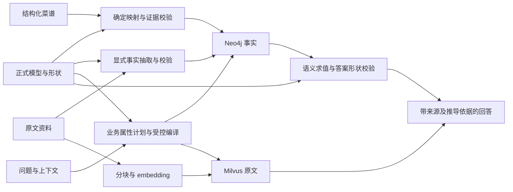

<div align="center">
  
  <h3>领域可配置的知识问答系统</h3>
  <p>可执行 OWL / SHACL · Neo4j 事实 · Milvus 原文 · MySQL 应用状态</p>
</div>

## 当前架构

阅读源码可先看[项目代码导航](docs/PROJECT_STRUCTURE.md)：其中列出当前入口、问答阶段、存储边界、统一入库和维护命令。

GustoBot 默认菜谱领域加载版本化 OWL/RDFS 模型和 SHACL 形状，执行类型展开、身份绑定、数量求值和证据校验。当前正式模型为 `2026-11-17.1`，支持按明确口径筛选用量、合计用量和时长。名称、全文和概念／实体向量提供候选，候选必须回读真实对象后才能进入问题计划。结构化菜谱直接映射为事实；普通文档可显式抽取并校验事实。设备与通用领域保留各自的 YAML 契约。

| 组件 | 职责 |
| --- | --- |
| Neo4j | 有方向的事实、关系用量、来源与引文，执行受控过滤和完整范围计数 |
| Milvus | 独立的原文集合与概念／实体候选集合；候选按模型、embedding 指纹和 generation 隔离 |
| MySQL | HTTP 会话、上传资产、来源发布与任务，以及候选 generation、租约、发布指针和校准策略 |
| OWL/RDFS + SHACL | 菜谱语义、身份与查询绑定、类型展开及实际图形状校验；YAML 仅加载和来源映射 |



问题计划表达对象、业务属性及条件，关系和字段由正式模型编译。常见确定问题可以省去规划模型调用；OWL-RL、SHACL 和单位计算不调用 LLM。具体支持范围、模型版本与显式再导入见[领域服务](docs/DOMAIN_KNOWLEDGE.md)。

## 启动

需要 Docker Compose；本地 Python 支持 3.10–3.13。先复制示例配置，填写 MySQL、Neo4j 密码，以及需要使用的模型服务凭据：

```powershell
Copy-Item .env.example .env
docker compose --env-file .env config --quiet
docker compose --env-file .env --profile setup build backend migrate
docker compose --env-file .env up -d mysql neo4j milvus
docker compose --env-file .env --profile setup run --rm migrate
docker compose --env-file .env up -d backend
```

默认服务为后端、MySQL、Neo4j 和 Milvus。MySQL 迁移必须显式执行；后端入口只运行 `scripts/migrate_database.py --check`，schema 缺失或版本不匹配会阻止启动。镜像构建和应用启动不调用模型、不自动导入资料。Redis 属于 `cache` 可选 profile。

访问 [API 文档](http://localhost:8000/docs)。前端单独启动：

```powershell
Set-Location web
npm install
npm run dev
```

前端地址以 Vite 输出为准。Python 本地运行、端口和模型配置见 [快速启动](docs/QUICK_START.md)。

### 知识管理后台

开发服务运行后，打开 [知识管理](http://localhost:5174/admin.html)。后台使用实际来源数据，支持文档上传、粘贴文本、结构化菜谱 JSON 导入、来源与任务核对、图谱候选抽取及校验、问答测试。操作说明见[后台使用指南](docs/ADMIN_GUIDE.md)。

后台沿用当前本地单人匿名服务方式，尚未配置管理员登录；对外部署前需要补充管理接口的认证与授权。

## 显式导入

以下操作由使用者选择执行。菜谱事实导入不需要模型重新抽取：

```powershell
docker compose --env-file .env exec backend python scripts/import_knowledge.py recipes --path data/recipe.json --limit 10
```

原文入库需要已配置的 embedding 服务：

```powershell
docker compose --env-file .env exec backend python scripts/import_knowledge.py documents --path data/kb/data.txt
```

上传附件与长期知识入库是独立操作。事实校验、抽取和图查询接口见 [领域知识服务](docs/DOMAIN_KNOWLEDGE.md)，持久卷和升级步骤见 [部署](docs/DEPLOYMENT.md)。

## 候选索引与发布

语义候选默认 `SEMANTIC_LINKING_MODE=off`。配置明确的 `SEMANTIC_EMBEDDING_REVISION` 后，先审计当前图范围，再构建和核对候选：

```powershell
docker compose --env-file .env exec backend python scripts/build_semantic_index.py bootstrap --audit
docker compose --env-file .env exec backend python scripts/build_semantic_index.py build --kind all --batch-size 64
docker compose --env-file .env exec backend python scripts/build_semantic_index.py status --kind all
```

旧事实的范围建立、显式发布、校准、`shadow`／`on` 切换和恢复顺序见 [候选索引运行手册](docs/RUNBOOK_SEMANTIC_INDEX.md)。`semantic-indexer` 是 `semantic` profile 下的可选 worker；它的健康检查只证明进程存活，索引就绪以发布状态和当前图修订为准。

## 数据与迁移

当前主链使用正式本体、Neo4j、Milvus 和 MySQL；旧 LightRAG 索引／缓存、独立 Text2SQL／pgvector 服务、未使用的插件和构建副本已清理。原始菜谱、食材、原文资料及已有 Docker 卷保留；旧 SQL 样例仅作为历史资料归档，旧操作指南集中在 `docs/archive/legacy/`。模型／数据迁移前需要停写并保存一致快照；本地文件清单可用 `scripts/verify_knowledge_snapshot.py` 核验，实际数据库恢复仍需独立演练。

内置菜谱来自 [OpenKG RecipeGraph](http://openkg.cn/dataset/recipegraph)。历史饮食文本的来源与许可边界见 [数据来源与血缘](docs/DATA_SOURCES.md)。本项目采用 [Apache License 2.0](LICENSE)。
