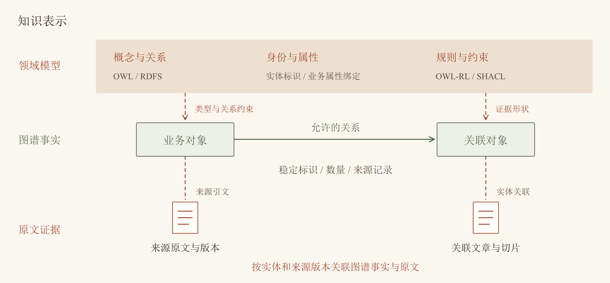
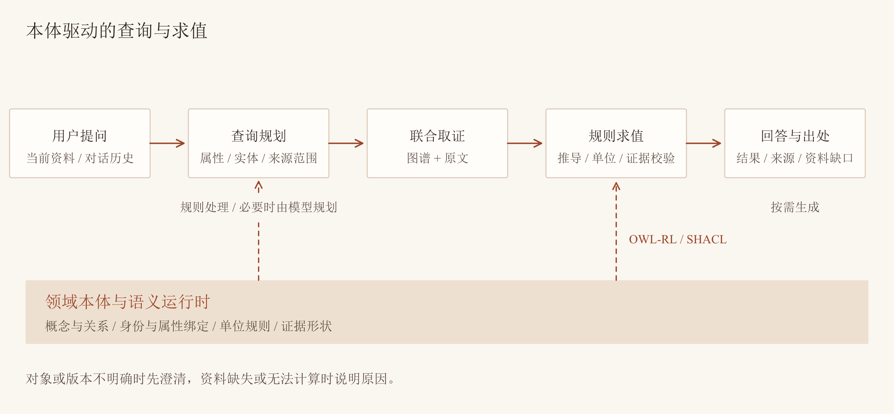

<p align="center">
  
</p>

<h1 align="center">GustoBot · 陶陶</h1>

<p align="center"><strong>基于领域本体的企业级知识问答</strong></p>

<p align="center"><strong>简体中文</strong> · <a href="./README.en.md">English</a></p>

<p align="center">
  <a href="#核心能力">核心能力</a> ·
  <a href="#快速开始">快速开始</a> ·
  <a href="#技术架构">技术架构</a> ·
  <a href="#开发文档">开发文档</a>
</p>

<p align="center">
  <a href="./docs/ARCHITECTURE_FLOW.md"></a>
  <a href="https://docs.langchain.com/oss/python/langchain/overview"></a>
  <a href="https://docs.langchain.com/oss/python/langgraph/overview"></a>
  <a href="https://fastapi.tiangolo.com/"></a>
  <a href="./docs/ONTOLOGY_REUSE.md"></a>
  <a href="https://www.docker.com/"></a>
  <a href="./LICENSE"></a>
</p>

## GustoBot 是什么

GustoBot 是一个基于领域本体的知识库问答系统，支持查询知识图谱和原文资料。

## 核心能力

### 本体定义与资料入库

菜谱本体用 OWL/RDFS 描述概念与关系，用 SHACL 检查入库事实和查询所需的事实证据。对象身份、查询属性和单位规则也由这套定义管理。

结构化记录按字段映射写入图谱，保留来源引文。文章分块并发布后可参与向量检索，也可以按实体、来源和版本关联到图谱，供回答时一起查阅。

<p align="center">
  <a href="./docs/assets/architecture/knowledge-representation-zh.png">
    
  </a>
</p>

文档可以只保留原文供检索。要从中提取图谱事实，需先抽取候选，再由人工核对并通过校验。

### 查询、计算与回答

回答时，系统会确定相关对象和来源版本，查询本体允许的图谱属性，并结合选中的资料与已发布文档。简单问题直接按规则处理；条件较复杂时，由模型生成查询计划。

对于已支持的属性，程序按本体规则计算结果、检查事实证据，需要归纳说明时再由模型组织回答。做法或版本有歧义时，先请用户确认；资料缺失时说明缺少哪部分。

<p align="center">
  <a href="./docs/assets/architecture/knowledge-reasoning-zh.png">
    
  </a>
</p>

明确记载的用量可按单位规则换算；“适量”等定性用量沿用原文。回答具体做法时，以选定版本的菜谱为准，相关文章补充背景。

### 知识库与对话管理

后台可以查看来源原文、发布或撤回文档、删除文档记录、审核待入图的候选事实，以及查阅已保存的对话。聊天页面显示处理进度和来源。知识更新需通过入库或审核操作提交，生成的回答不会自动写回图谱。

## 快速开始

安装 Docker 和 Docker Compose，然后克隆仓库、复制配置文件。

```bash
git clone https://github.com/skygazer42/GustoBot.git
cd GustoBot
cp .env.example .env
```

Windows PowerShell 使用 `Copy-Item .env.example .env` 复制配置。编辑 `.env`，填写以下设置：

- **聊天模型**：填写 `LLM_BASE_URL`、`LLM_API_KEY` 和 `LLM_MODEL`。
- **向量模型**：填写 `EMBEDDING_BASE_URL`、`EMBEDDING_API_KEY`、`EMBEDDING_MODEL`，并让 `EMBEDDING_DIMENSION` 匹配实际输出维度。
- **存储连接**：更换 `MYSQL_PASSWORD`、`MYSQL_ROOT_PASSWORD`、`NEO4J_PASSWORD`，同步 `DATABASE_URL` 中的 MySQL 应用账号与密码。连接串中的保留字符需 URL 编码。
- **后台登录**：配置 `GUSTOBOT_ADMIN_PASSWORD` 和独立随机的 `SECRET_KEY`（至少 32 字节）。

聊天和向量模型可分别连接 OpenAI-compatible 接口。配置、本地开发和资料导入步骤见[快速启动](./docs/QUICK_START.md)。

```bash
docker compose --env-file .env up -d --build
```


## 技术架构

入库和查询共用一套本体定义。图谱和原文分别存储，由同一个查询服务读取。

<p align="center">
  <a href="./docs/assets/architecture/knowledge-overview-zh.png">
    
  </a>
</p>

| 模块 | 作用 |
| --- | --- |
| 页面与接口 | Vue 提供页面，FastAPI 提供接口，AG-UI 传送进度和回复；LangGraph 转接普通聊天请求 |
| 查询服务 | 读取本体定义，生成受控查询，检索资料并计算、校验结果 |
| 图谱与原文 | Neo4j 保存事实和引文，Milvus 保存已发布文档的向量 |
| 会话与发布记录 | MySQL 保存对话、来源版本、入库任务和发布状态 |
| 模型 | LLM 负责候选抽取、必要的查询规划和回答整理；Embedding 模型生成向量 |


### 接入其他领域

默认菜谱使用 OWL/RDFS 和 SHACL 文件，加载时执行 OWL-RL 推导。设备和通用领域提供 YAML 样板。接入新领域时，需要编写并验证本体、字段映射和查询绑定；现有查询提示及部分数值计算仍与菜谱有关。


## 开发文档

- [快速启动](./docs/QUICK_START.md)：模型配置、本地开发与资料导入。
- [领域知识服务](./docs/DOMAIN_KNOWLEDGE.md)：知识表示、查询计划、证据与 API 契约。
- [本体复用说明](./docs/ONTOLOGY_REUSE.md)：Schema.org 子集、词汇来源与映射依据。
- [管理后台指南](./docs/ADMIN_GUIDE.md)：文档发布、图谱审核、问答测试和对话记录。
- [部署与升级](./docs/DEPLOYMENT.md)：存储配置、版本升级与运行维护。
- [项目代码导航](./docs/PROJECT_STRUCTURE.md)：代码入口与模块职责。

## 数据与许可证

项目代码采用 [Apache License 2.0](./LICENSE)。第三方菜谱、文档和图片按各自来源与许可使用，详见[数据来源与血缘](./docs/DATA_SOURCES.md)。

问题与建议请提交到 [GitHub Issues](https://github.com/skygazer42/GustoBot/issues)。
