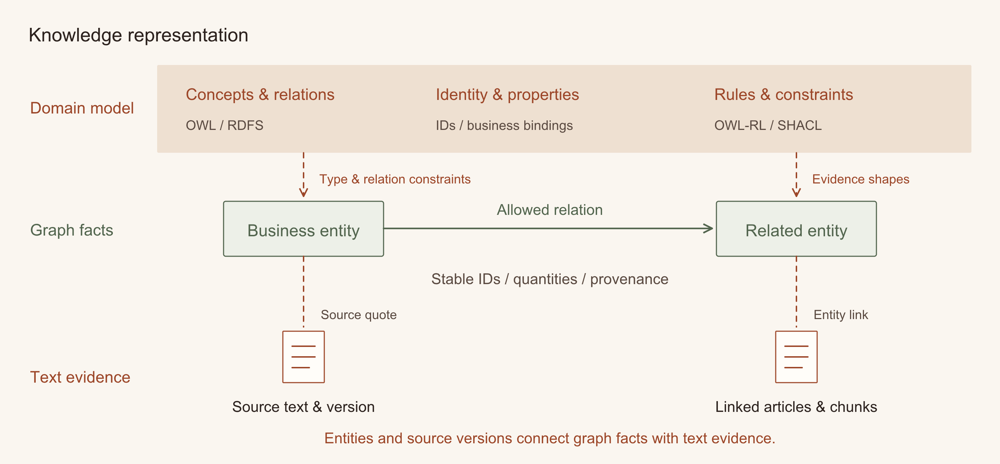
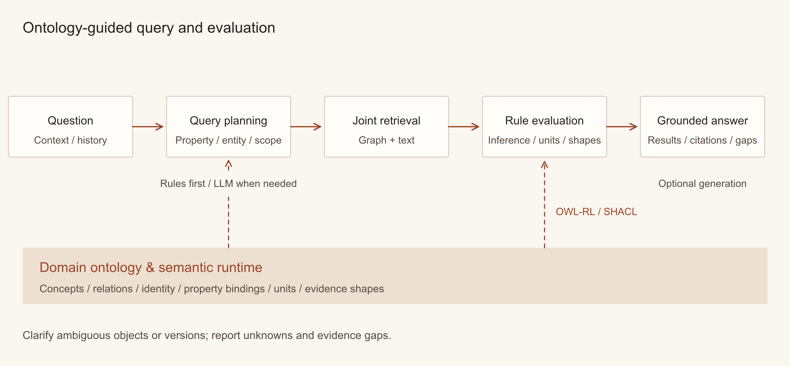
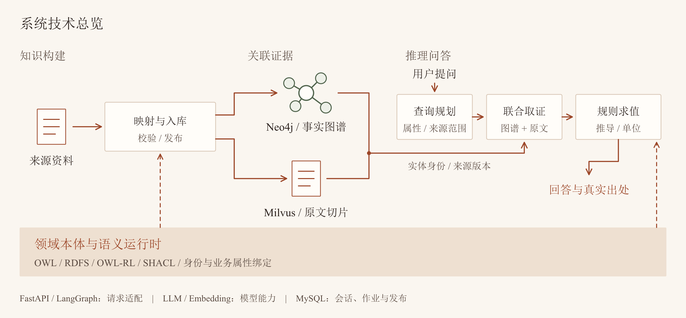

<p align="center">
  
</p>

<h1 align="center">GustoBot · 陶陶</h1>

<p align="center"><strong>本体驱动的知识服务</strong><br>领域语义 · 图文联合取证 · 可追溯回答</p>

<p align="center"><a href="./README.md">English</a> · <strong>简体中文</strong></p>

<p align="center">
  <a href="#核心能力">核心能力</a> ·
  <a href="#快速开始">快速开始</a> ·
  <a href="#技术架构">技术架构</a> ·
  <a href="#开发文档">开发文档</a>
</p>

<p align="center">
  <a href="./docs/ONTOLOGY_REUSE.md"></a>
  <a href="https://www.docker.com/"></a>
  <a href="./LICENSE"></a>
</p>

## GustoBot 是什么

GustoBot 将领域本体、图谱事实和原文资料接入统一问答服务。领域本体定义概念、关系与可执行约束，图谱保存具体事实，原文保留上下文。系统按这些定义规划查询、联合取证并计算结果，回答附带实际使用的来源。

**菜谱是当前的应用领域。** 同一道菜的不同做法保留各自版本，用量、步骤和耗时归属于具体做法；相关文章可以补充背景。领域定义可以配置，新领域仍需补齐模型、字段映射和查询绑定。

## 核心能力

### 本体约束的知识表示

默认菜谱使用版本化的 OWL/RDFS 与 SHACL 定义概念、关系、身份、业务属性、单位和证据形状。运行时加载并编译这些定义，让资料构建与查询求值共用领域语义。

图事实保存对象关系和原始引文；文档保留完整语境并发布为可检索的片段。两者通过实体关联、来源身份和版本连接，可共同支持一次回答。

<p align="center">
  <a href="./docs/assets/architecture/knowledge-representation.png">
    
  </a>
</p>

结构化记录按来源字段确定性映射并校验后入图。文档可只发布原文向量；需要图事实时，再显式抽取候选、人工核对并校验。[知识表示与入库契约](./docs/DOMAIN_KNOWLEDGE.md)

### 本体驱动的查询与求值

简单问题走确定性路径，复杂问题由模型选择本体允许的业务属性和条件。服务解析对象与来源版本，按需联合检索图谱事实、当前资料和关联文章。

正式业务属性的事实求值执行支持的本体推导、数量计算与证据校验。结构化结果可以直接返回，需要综合说明时再基于证据生成回答。对象不明确时先澄清；未知值、定性数量和资料缺口按实际情况保留。

<p align="center">
  <a href="./docs/assets/architecture/knowledge-reasoning.png">
    
  </a>
</p>

例如，查询糖的用量时可以按声明的单位规则换算；原文中的“适量”保持定性描述。选择某份做法后，以该版本原文为配方依据，相关文章用于补充背景。[查询与求值边界](./docs/DOMAIN_KNOWLEDGE.md)

### 可追溯的知识发布与问答

管理后台提供原文核对、文档发布与撤回、文档记录删除、图谱候选审核和只读对话记录。聊天界面显示执行进度及实际出处，回答保留所用来源和版本。知识发布由显式操作完成，生成答案不会自动写回图谱。[管理后台指南](./docs/ADMIN_GUIDE.md)

## 快速开始

准备 Docker 与 Docker Compose，然后克隆仓库并复制配置。

```bash
git clone https://github.com/skygazer42/GustoBot.git
cd GustoBot
cp .env.example .env
```

Windows PowerShell 可用 `Copy-Item .env.example .env` 复制配置。编辑 `.env`，替换占位值：

- **聊天模型**：填写 `LLM_BASE_URL`、`LLM_API_KEY` 和 `LLM_MODEL`。
- **向量模型**：填写 `EMBEDDING_BASE_URL`、`EMBEDDING_API_KEY`、`EMBEDDING_MODEL`，并让 `EMBEDDING_DIMENSION` 匹配实际输出维度。
- **存储连接**：更换 `MYSQL_PASSWORD`、`MYSQL_ROOT_PASSWORD`、`NEO4J_PASSWORD`，同步 `DATABASE_URL` 中的 MySQL 应用账号与密码。连接串中的保留字符需 URL 编码。
- **后台登录**：配置 `GUSTOBOT_ADMIN_PASSWORD` 和独立随机的 `SECRET_KEY`（至少 32 字节）。

聊天与向量接口采用 OpenAI-compatible 格式，可分别配置。完整配置、本地开发和资料导入方式见[快速启动指南](./docs/QUICK_START.md)。

```bash
docker compose --env-file .env up -d --build
```

| 入口 | 默认地址 |
| --- | --- |
| 前台与陶陶对话 | <http://localhost:8000/> |
| 知识管理后台 | <http://localhost:8000/admin.html> |
| API 文档 | <http://localhost:8000/docs> |
| 健康检查 | <http://localhost:8000/health> |

端口以实际配置为准。菜谱目录与已发布知识库分别准备：目录快照、配图、文档发布和事实导入方式见[数据来源与构建](./docs/DATA_SOURCES.md)及[管理后台指南](./docs/ADMIN_GUIDE.md)。

## 技术架构

知识构建与问答使用同一领域定义。构建阶段分别发布图事实与原文片段；查询阶段由统一服务规划和取证，再执行规则求值与有据表达。

<p align="center">
  <a href="./docs/assets/architecture/knowledge-overview-zh.png">
    
  </a>
</p>

[高清 PNG](./docs/assets/architecture/knowledge-overview-zh.png) · [矢量 SVG](./docs/assets/architecture/knowledge-overview-zh.svg) · [英文版](./README.md#architecture)

| 职责 | 当前实现 |
| --- | --- |
| 请求与界面 | Vue、FastAPI、AG-UI 流式事件；LangGraph 将普通对话适配到统一查询服务 |
| 领域语义与问答 | 本体编译、业务属性绑定、受控查询、图文取证、规则计算和证据求值 |
| 知识存储 | Neo4j 保存事实及引文，Milvus 保存已发布文档向量 |
| 会话与发布 | MySQL 保存会话、消息、来源版本、入库作业与发布状态 |
| 模型能力 | LLM 用于显式候选抽取、必要的查询规划与有据表达；Embedding 用于向量化 |

[统一查询服务](./gustobot/application/services/knowledge_query.py) · [入库服务](./gustobot/application/services/knowledge_ingestion.py) · [语义运行时](./gustobot/infrastructure/knowledge/semantic_runtime.py) · [图稿与详细流程](./docs/ARCHITECTURE.md)

### 领域复用与支持范围

默认菜谱已使用正式 OWL/RDFS、OWL-RL 与 SHACL 运行链。设备和通用领域提供 YAML 契约样板，接入新领域需要配置并验证对应的语义、映射和查询绑定；现有业务求值仍包含菜谱专属能力。

当前支持明确的本地本体片段和受控查询。原文质量、实体对齐与别名裁决仍依赖来源和业务核对；推导与证据校验不替代资料真实性判断。[领域配置](./gustobot/config/domains/) · [正式语义边界](./docs/DOMAIN_KNOWLEDGE.md)

## 开发文档

- [快速启动](./docs/QUICK_START.md)：模型配置、本地开发与资料导入。
- [领域知识服务](./docs/DOMAIN_KNOWLEDGE.md)：知识表示、查询计划、证据与 API 契约。
- [本体复用说明](./docs/ONTOLOGY_REUSE.md)：Schema.org 子集、词汇来源与映射依据。
- [管理后台指南](./docs/ADMIN_GUIDE.md)：文档发布、图谱审核、问答测试和对话记录。
- [部署与升级](./docs/DEPLOYMENT.md)：存储配置、版本升级与运行维护。
- [项目代码导航](./docs/PROJECT_STRUCTURE.md)：代码入口与模块职责。

## 数据与许可证

项目代码采用 [Apache License 2.0](./LICENSE)。第三方菜谱、文档和图片按各自来源与许可使用，详见[数据来源与血缘](./docs/DATA_SOURCES.md)。

欢迎通过 [GitHub Issues](https://github.com/skygazer42/GustoBot/issues) 提交问题和改进建议。
