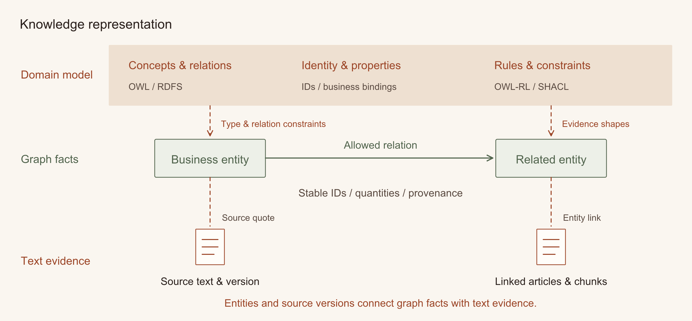
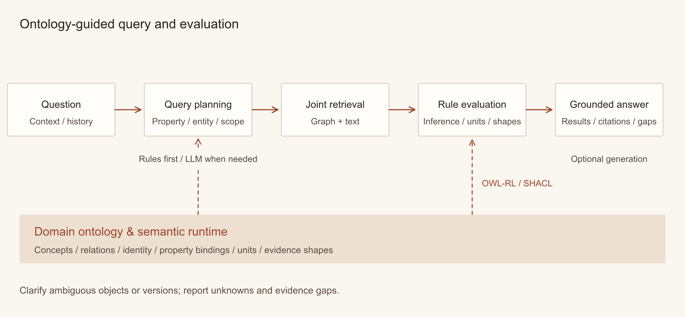
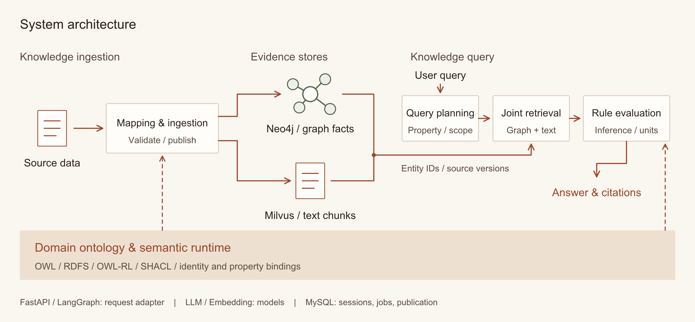
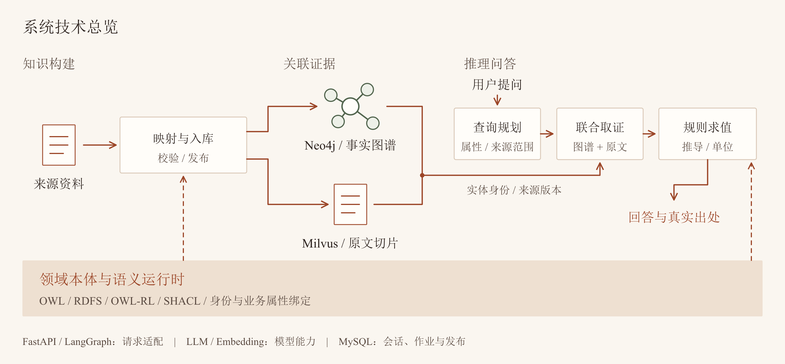

# 本体驱动知识服务图示

README 按“知识表示、查询与求值、技术总览”介绍系统。图示说明顺序参考 [KAG README](https://github.com/OpenSPG/KAG/blob/master/README_cn.md)，内容按 GustoBot 当前实现重绘；KAG 的图形资产、模块和多轮求解算法没有移植到项目中。

## 本体约束的知识表示

<p align="center"></p>

[PNG](assets/architecture/knowledge-representation.png) · [SVG](assets/architecture/knowledge-representation.svg)

领域定义描述类型、关系、身份、业务属性和可执行约束。实例图保存来源事实；事实通过引文连接来源原文，文章还可通过实体与版本范围关联到图中对象。普通文档可独立检索，不要求事先抽取图事实。

图中的“Business entity”“Related entity”是机制示意，不代表新增的运行时类型。来源引文关联与文章实体关联各有职责，不表示全库已建立通用双向倒排索引。

## 查询与求值

<p align="center"></p>

[PNG](assets/architecture/knowledge-reasoning.png) · [SVG](assets/architecture/knowledge-reasoning.svg)

一次查询经过受控规划、实体与来源绑定、图文取证及答案求值。简单问题可以走确定路径，复杂知识查询最多一次模型规划和一次最终生成；正式事实求值出现违规诊断时，直接返回确定结果与缺口，不继续让模型补齐。

正式业务属性的事实证据使用本体推导、单位计算与相应 SHACL 形状。普通原文回答不等于经过 SHACL 真实性认证。选定菜谱时以当前完整原文为配方依据，概念事实和相关文章只补充背景。

图中的直线为阅读主流程，虚线表示共享语义约束。澄清、异常和入库的详细分支保留在[执行流程](ARCHITECTURE_FLOW.md)，其中也有可编辑的 Mermaid。

## 技术总览

用户选定原对比页的 **03 技术总览英文版**，用于[英文 README](../README.md#architecture)。[中文 README](../README.zh-CN.md#技术架构)使用相同构图与关系的中文版。

<p align="center"></p>

[英文 PNG](assets/architecture/knowledge-overview.png) · [英文 SVG](assets/architecture/knowledge-overview.svg)

<p align="center"></p>

[中文 PNG](assets/architecture/knowledge-overview-zh.png) · [中文 SVG](assets/architecture/knowledge-overview-zh.svg)

知识构建分别发布图事实与文档原文。Neo4j 持久化事实和引文，Milvus 保存已发布文档向量，MySQL 保存会话、作业和版本发布状态。LangGraph 是普通聊天的薄适配层，规划、检索与表达共用统一查询服务。

文档不会默认同时写入图谱与向量库：图事实需要显式抽取候选、审核并校验。生成回答不会自动回写知识。领域定义可配置，但默认菜谱的正式本体、数值求值和其他领域样板的能力范围有差异。

## 在 README 中引用

三个英文图使用 Arial 常规字重和小字号；技术总览另附中文版，中文使用宋体，英文和数字使用 Times New Roman，均为常规字重。README 展示宽度为 800px。PNG 均为 2800×1300；SVG 的文字已转为路径，保留可访问标题和标签，无脚本、外链字体或前端运行依赖，可打开原尺寸查看细节。

```markdown


```

图表示逻辑职责与信息流，不表示运行副本数量或线上状态。当前行为依据：[领域服务](DOMAIN_KNOWLEDGE.md)、[统一查询](../gustobot/application/services/knowledge_query.py)、[知识入库](../gustobot/application/services/knowledge_ingestion.py)、[语义运行时](../gustobot/infrastructure/knowledge/semantic_runtime.py)。前期候选保留在[历史图稿](ARCHITECTURE_OPTIONS.md)。
