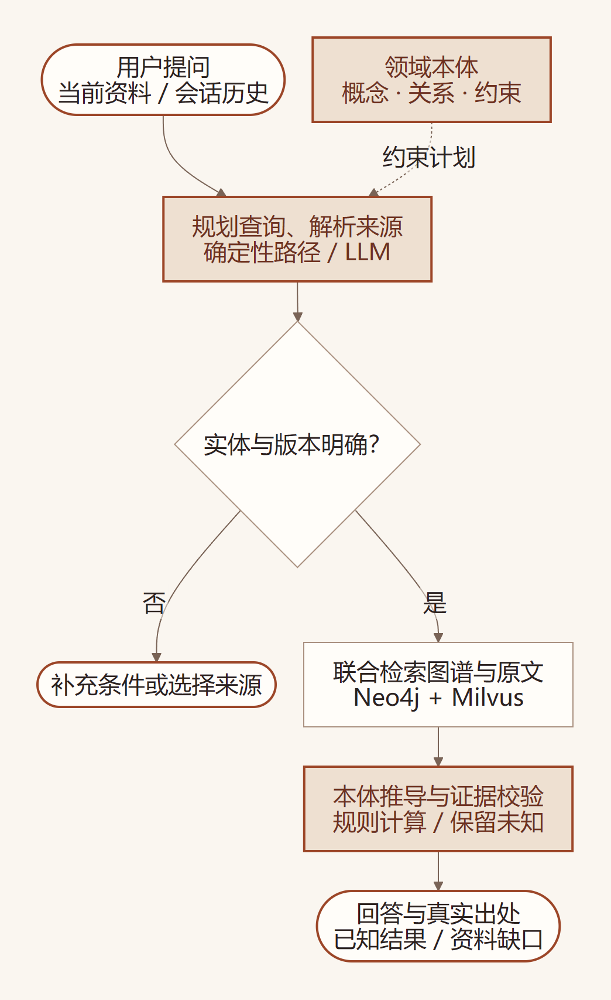
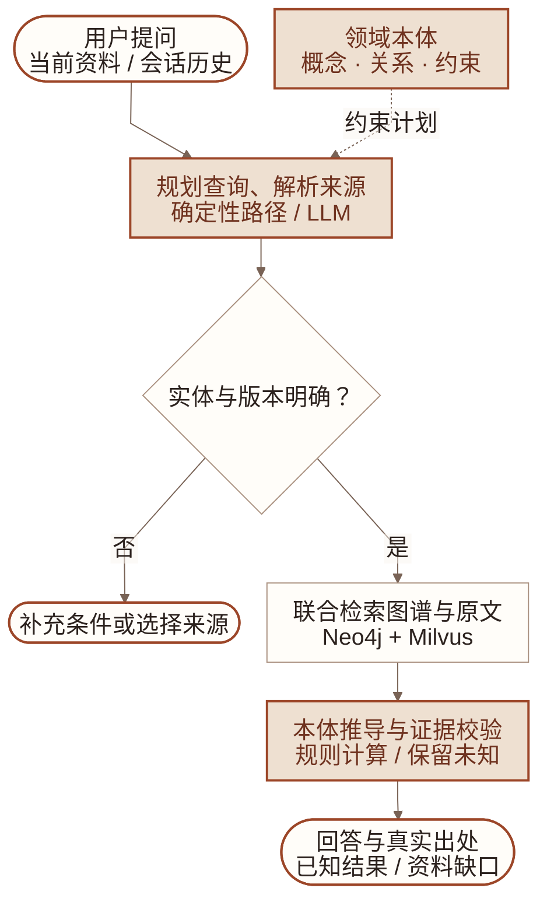
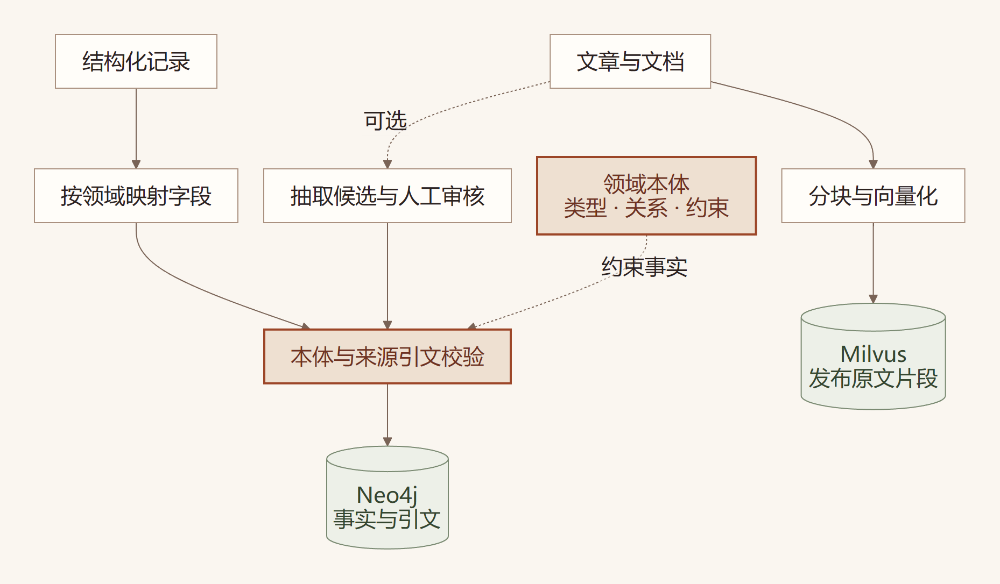
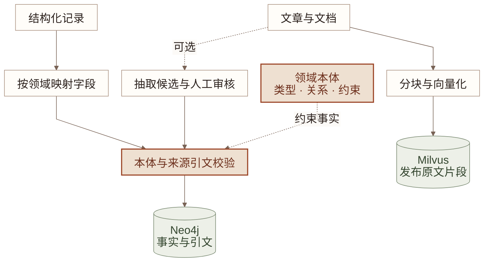

# 本体驱动知识服务流程

本页保留执行细节和 Mermaid 源码。README 当前使用的知识表示、查询求值与技术总览见[机制图说明](ARCHITECTURE.md)。

采用标准流程节点、判断分支和有向箭头，分开说明问答与入库。两张图共用领域本体，菜谱不是流程里的固定类型。

## 问答流程

用户问题先按本体规划并解析来源。对象或版本有歧义时先澄清；明确后按需联合检索事实与原文，再执行本体推导、规则计算和事实证据校验，返回有依据的结果及出处。

<p align="center"></p>

[PNG](assets/architecture/ontology-flow.png) · [SVG](assets/architecture/ontology-flow.svg) · [Mermaid 源码](assets/architecture/ontology-flow.mmd)

<details>
<summary>查看可直接放入 README 的 Mermaid</summary>



</details>

## 知识入库流程

结构化记录按领域映射字段，通过本体和引文校验后写入事实图。文章可只发布原文向量；需要图事实时，显式抽取候选、人工审核并校验后入图。

<p align="center"></p>

[PNG](assets/architecture/ontology-ingestion.png) · [SVG](assets/architecture/ontology-ingestion.svg) · [Mermaid 源码](assets/architecture/ontology-ingestion.mmd)

<details>
<summary>查看知识入库 Mermaid</summary>



</details>

## README 图片用法

```markdown


```

问答图建议展示宽度为 520px，入库图为 760px；支持 Mermaid 的 Markdown 阅读器也可以直接粘贴对应源码。已在 Mermaid 11.4.1 中实际解析、渲染，并检查静态图片的展示尺寸。SVG 为纯矢量图与文本，无脚本、HTML 外嵌节点或远程资源；PNG 可直接引用。

## 执行边界

实线表示数据处理方向，虚线表示语义约束或可选抽取。联合检索按问题与实际证据决定取用范围，图谱和原文可以共同支持回答。SHACL 校验的是事实及当前问题需要的证据形状，不负责判断每篇文章是否真实。规则不支持、证据缺失或数据未知时按实际结果说明，不让模型补造事实。

当前资料原文可以直接作为证据，图中未展开上传、UI 流式事件和模型调用细节。聊天入口将会话与完整消息保存到 MySQL；独立知识查询不一定创建会话。生成回答不会自动写回知识图谱。领域语义可配置，不宣称支持任意 OWL 或规则语言。

依据：[领域服务](DOMAIN_KNOWLEDGE.md)、[统一查询](../gustobot/application/services/knowledge_query.py)、[语义运行时](../gustobot/infrastructure/knowledge/semantic_runtime.py)、[入库服务](../gustobot/application/services/knowledge_ingestion.py)。前两轮架构图保留在[历史候选](ARCHITECTURE_OPTIONS.md)。
