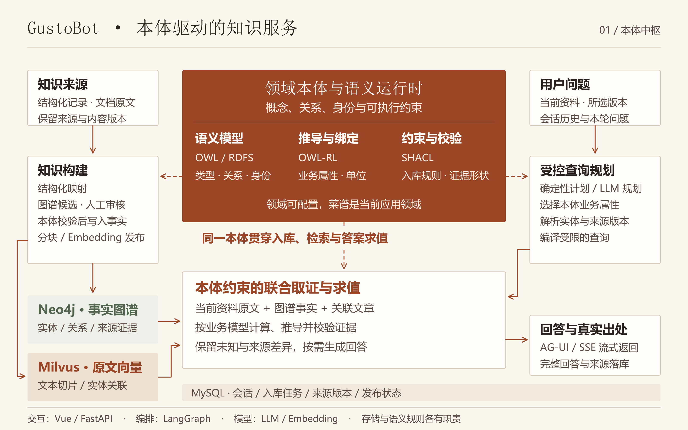
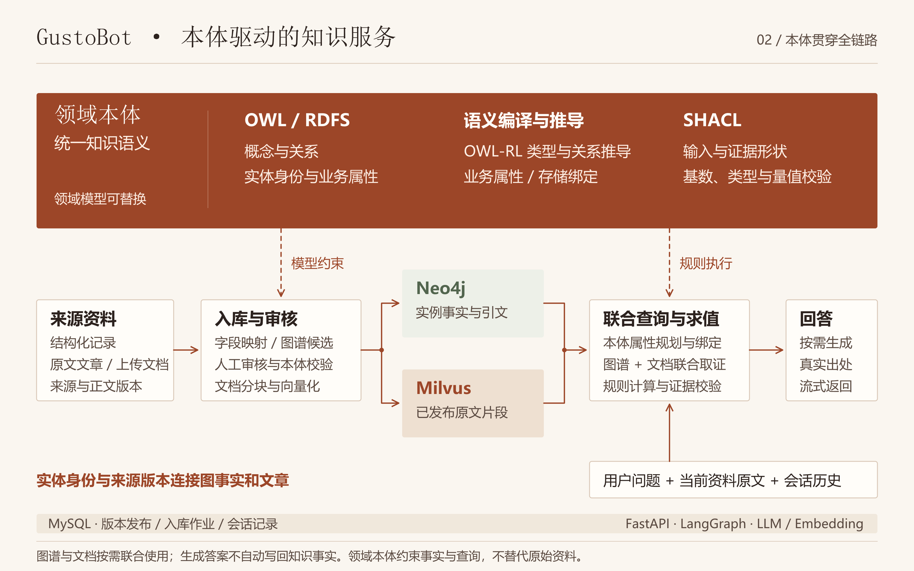
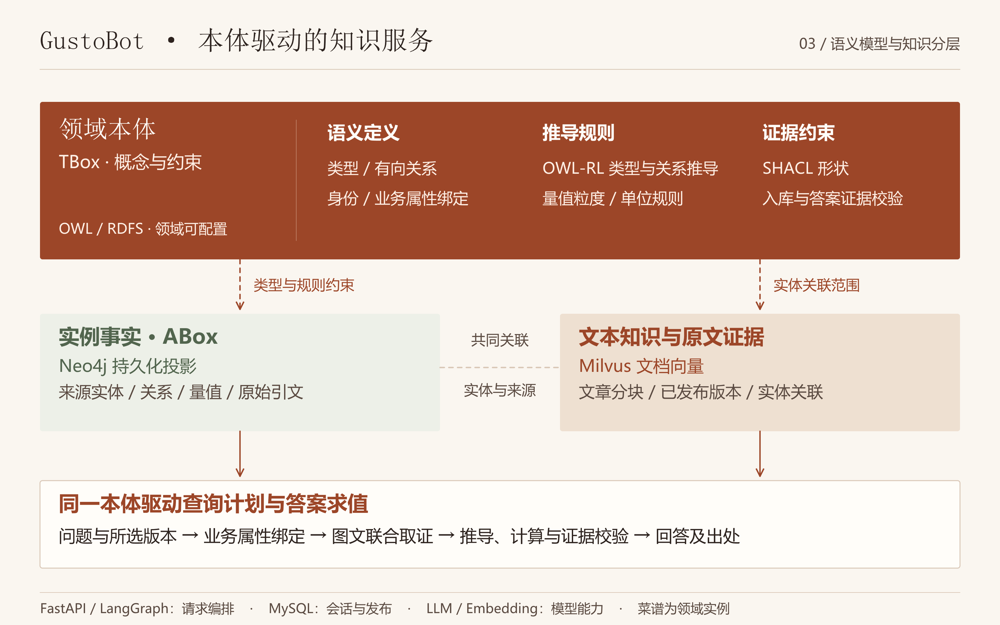

# 本体驱动架构图候选

本页保留前两轮的架构图候选。当前 README 按用户选定的 KAG 参考，使用[知识表示、查询求值与技术总览](ARCHITECTURE.md)三张机制图；[执行流程](ARCHITECTURE_FLOW.md)另有问答、入库细节及 Mermaid 源码。下列旧图供历史回看。

| 方案 | 主要表达 | 图片 |
| --- | --- | --- |
| 01 本体中枢 | 本体同时约束知识构建、查询规划与答案求值 | [PNG](assets/architecture/01-ontology-core.png) · [SVG](assets/architecture/01-ontology-core.svg) |
| 02 本体贯穿全链路 | 同一语义模型贯穿资料接入、联合取证与回答 | [PNG](assets/architecture/02-ontology-pipeline.png) · [SVG](assets/architecture/02-ontology-pipeline.svg) |
| 03 语义模型与知识分层 | 区分本体 TBox、实例事实 ABox 和文本证据 | [PNG](assets/architecture/03-ontology-layers.png) · [SVG](assets/architecture/03-ontology-layers.svg) |

## 01 · 本体中枢

本体处于架构中心，知识来源与用户问题从两侧进入；图事实和原文在本体约束下联合取证，输出回答及出处。



## 02 · 本体贯穿全链路

上方统一展示语义模型与执行规则，下方按资料、入库、图文存储、查询和回答展开，适合解释知识处理链路。



## 03 · 语义模型与知识分层

区分定义、事实和原文三个层次，强调实体身份与来源关联，以及同一本体驱动查询计划和答案求值。



## 在根目录 README 中使用

PNG 为 3200×2000，SVG 为同构图的矢量版。SVG 文字已转路径，不需要安装图中字体；`title`、`desc` 和文字标签保留在 SVG 中。两种格式均无脚本、远程素材或前端运行依赖。

```markdown

```

需要限制展示宽度并可点击查看高清图时：

```html
<p align="center">
  <a href="./docs/assets/architecture/01-ontology-core.png">
    
  </a>
</p>
```

使用其他方案时替换文件名即可；需要矢量显示时将扩展名改为 `.svg`。

## 图中职责与依据

图表示逻辑架构，不表示实时运行状态或部署副本数量。本体定义概念、关系和执行约束，事实来自带出处的资料；OWL-RL 负责受支持的类型与关系推导，身份、业务属性及单位由语义编译器和运行时绑定。SHACL 校验输入事实与问题所需的证据形状，不替代原文真实性判断。

结构化资料可确定性映射入图；文档可以仅分块发布，也可以显式抽取候选、人工审核并校验后入图。图事实和文本通过实体及来源版本关联，回答时按需联合使用。生成答案不会自动写回事实。领域模型可配置，图中的菜谱只是当前应用领域。

依据：[领域知识服务](DOMAIN_KNOWLEDGE.md)、[部署说明](DEPLOYMENT.md)、[统一查询](../gustobot/application/services/knowledge_query.py)、[语义运行时](../gustobot/infrastructure/knowledge/semantic_runtime.py)、[知识入库](../gustobot/application/services/knowledge_ingestion.py)、[菜谱本体](../gustobot/config/ontologies/recipes.ttl)和 [SHACL 形状](../gustobot/config/ontologies/recipes.shacl.ttl)。

这些历史候选已检查原生尺寸渲染和 760px 展示宽度。[预览辅助页](../web/design-lab/architecture-directions/index.html)展示最新的机制图。
