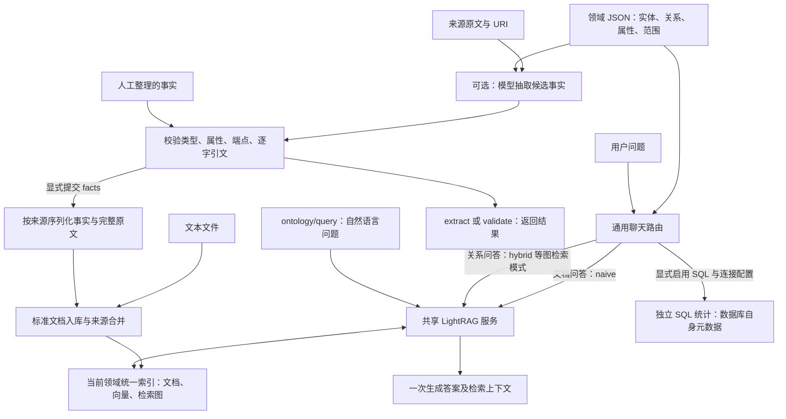

# 一套图检索与领域配置

聊天图问答、本体查询和文档问答复用同一个 LightRAG 服务及当前领域索引。已删除自有 Neo4j 事实存储、Text2Cypher、固定菜谱图查询和第二套图问答。LightRAG 固定为 `lightrag-hku==1.4.9.8`，以 Python 库运行，首次使用时初始化。

## 实际流程



LightRAG 自己维护检索图；业务代码不生成或执行 Cypher。文档语义问答使用 `naive`，关系问答使用 `LIGHTRAG_RETRIEVAL_MODE`（默认 `hybrid`），二者读取同一索引。上传资料一次后可以用于两种查询。

## 领域与索引

```powershell
$env:KNOWLEDGE_DOMAIN_FILE = "gustobot/config/domains/equipment.json"
python -m uvicorn gustobot.main:application --reload
```

提供了 `recipes.json`、`equipment.json`、`generic.json`。新增行业需要自己的类型定义与语料，公共代码无须改成行业专属实现。配置按绝对路径缓存，切换后重启后端；不同领域进程使用不同索引目录。

- `entity_types/relation_types`：实体与关系类型、方向和属性，用于输入事实校验。LightRAG 的实体类型列表只引导其自动抽取，不是检索图的强约束。
- `document_scope`、关键词和 `assistant_instructions`：路由、澄清和回答范围。
- `document_index_namespace`：默认领域 ID，在 `LIGHTRAG_WORKING_DIR` 下隔离索引；拒绝绝对路径和 `..`。菜谱显式指定 `.` 沿用旧 LightRAG 文档索引。
- `document_backend`：所有内置领域默认 `lightrag`。已有部署若仍使用旧向量 KB，可显式选择 `legacy_kb`；其文档链路保留，图问答仍统一使用 LightRAG。
- `http_router_modules`：默认空。旧向量 CRUD 接口只有显式配置 `gustobot.interfaces.http.knowledge_router` 才注册；旧 `/knowledge/graph` 与 `/knowledge/graph/qa` 已删除。
- `sql_enabled/sql_db_type`：可选统计 SQL，默认关闭。还须在环境中配置 `SQL_DATABASE_URL`，连接凭据不进入公开领域 JSON 或抽取提示。SQL schema 读取关系数据库自身元数据，移除了 Neo4j 元数据依赖；连接账号应限制为只读。

文本上传支持 `.txt/.md/.json/.csv/.log`。Excel 在 LightRAG 模式下先转换 CSV/文本；PDF 先解析成带来源的文本。本轮未新增解析依赖。

## 本体接口只做输入约束

路径前缀为 `/api/v1/ontology`：

| 接口 | 当前行为 |
| --- | --- |
| `GET /domain` | 当前领域定义，无模型与数据库依赖 |
| `POST /extract` | 来源原文 → 模型候选 → 校验 → 返回，不自动入库 |
| `POST /validate` | 校验实体、关系、属性与原文引证，返回数量 |
| `POST /facts` | 校验后序列化来源及事实，通过标准 LightRAG 文档入库；返回文档导入统计 |
| `POST /query` | `question/mode/top_k` 自然语言查询，共享 LightRAG 回答与检索上下文 |

`/extract` 示例：`{"sources":[{"id":"manual-v1","text":"原文内容","uri":"manual.pdf"}]}`。

设备示例可直接用 `docs/examples/equipment-facts.json`：

```powershell
$api = "http://localhost:8000/api/v1/ontology"
$facts = Get-Content docs/examples/equipment-facts.json -Raw -Encoding UTF8
Invoke-RestMethod "$api/validate" -Method Post -ContentType "application/json; charset=utf-8" -Body ([Text.Encoding]::UTF8.GetBytes($facts))
Invoke-RestMethod "$api/facts" -Method Post -ContentType "application/json; charset=utf-8" -Body ([Text.Encoding]::UTF8.GetBytes($facts))
$query = @{ question = "泵 A 的部件记录了什么故障？"; mode = "hybrid"; top_k = 10 } | ConvertTo-Json
Invoke-RestMethod "$api/query" -Method Post -ContentType "application/json; charset=utf-8" -Body ([Text.Encoding]::UTF8.GetBytes($query))
```

事实入库会保留原文、URI、实体属性、关系端点及引文，再由 LightRAG 抽取和合并进统一索引。这里复用普通 `ainsert`，没有采用 `ainsert_custom_kg`：1.4.9.8 的后者直接 upsert 同名节点/同端点关系，可能覆盖现有来源与描述。代价是已整理的事实再次经过模型抽取，导入需要模型与向量服务。

输入校验保证类型与引文符合输入契约，不保证模型对原文含义的理解正确。LightRAG 的默认检索图是无向简单图，合并时可能综合类型和描述；回答及返回的检索上下文不承诺仍是强类型、有向、逐边可证明的事实图。

旧 `anchor_ids/relation_types/max_hops/limit` 查询契约已移除；这些字段会被拒绝，不能静默当作已执行过滤。新的查询不提供精确路径、图约束过滤、Neo4j 事务、事实 ID 不变性或按事实 ID 更新/撤回保证。同内容文档沿用 LightRAG 去重语义，更新内容视作新的资料。

## 默认部署

`docker compose up --build` 默认启动后端，使用 SQLite 保存会话、使用本地 LightRAG 索引。不再启动 Neo4j，也不强制依赖 Redis/Milvus。

可选旧组件通过 profiles 启用：`legacy-kb`（Milvus/etcd/MinIO/PostgreSQL/KB ingest）、`legacy-cache`（Redis）、`sql`（示例 MySQL）。例如 `docker compose --profile legacy-kb up --build`，同时按实际使用配置领域 backend/路由和外部服务地址。只启用 profile 不会自动切换领域配置。已有 `.env` 若指定 MySQL，仍须启动其 profile 或使用外部数据库；SQLite 默认不会覆盖已有连接设置。

启动脚本只向明确的菜谱旧索引复制菜谱模板；Milvus seed 仅在 `legacy_kb` 配置下运行。菜谱 JSON 导入器仍是独立数据工具，拒绝其他领域，已移除其 Neo4j 导入模式。旧图数据库、Docker 数据卷和实际 `data/` 均未删除或自动迁移；需要的旧图资料应先导出文本或 JSON，再显式导入当前领域。

## 验证边界

测试通过离线 wrapper 屏蔽真实 `.env`，替换模型、向量与数据库边界。覆盖领域校验、同一运行时/索引、自然语言 API、来源保留、导入失败与取消、SQL 元数据和服务生命周期。真实模型服务、部署性能、多进程写入及旧图数据迁移尚未联测。Python 安装依赖仍含旧文档 KB 和 SQL 能力，本轮不宣称全部依赖已最小化。
