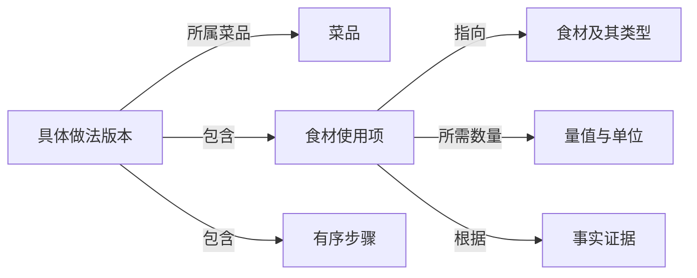

# 黑皮书、青皮书案例复核与设计纠偏

日期：2026-11-16。状态：本页保留案例核查与设计纠偏依据；后续正式模型及执行层已落到代码，当前契约见[领域服务](DOMAIN_KNOWLEDGE.md)，实施步骤与验证见[执行计划](superpowers/plans/2026-11-16-executable-recipe-ontology.md)。以下“当前实现差距”记录的是修正前状态，不再作为新实现的完成说明。

## 复核范围

核对用户提供 PDF 的实际页码与代码例子，重点阅读黑皮书第 77–83、132–135 页，青皮书第 139–150、232–235、285–289、326–331 页；渲染检查了黑皮书第 78 页与青皮书第 288 页。本次结论描述书内案例，不把书中的第三方仓库分析当作对其最新版本的重新审计。

## 例子里的本体如何真正工作

| 例子与页码 | 定义了什么 | 运行时谁消费定义 | 可以检查的实际效果 |
| --- | --- | --- | --- |
| 黑皮书 78–79，bkn-foundry | 对象主键、来源资源、mapped_field、关系 mapping_rules | 对象服务构建字段映射，关系查询把规则编译为数据源过滤/JOIN 条件，执行后映射回对象 | 逻辑对象能定位真实记录，声明关系能查出实例；JSON 成为执行输入 |
| 黑皮书 80–81，TypeDB | 实体、属性、关系角色、owns/plays/relates、类型继承 | TypeQL 编译器、类型系统与提交/操作时校验 | 查询父类型能展开子类型，违规写入由内核拒绝 |
| 黑皮书 132–133，Semantica Datalog | 基础事实与可递归规则 | derive_all 迭代到不动点，查询派生事实 | 未显式存储的 ancestor 结果可被推出，并可关联规则与前提的推导身份 |
| 黑皮书 134，abi 反例 | 标准 OWL 本体与校验文件 | 文本主要进入 LLM 提示，缺少相应正式推理引擎 | 文件存在不能证明形式化推理，LLM 的解释不能替代规则执行 |
| 青皮书 139–150，销售问数 | 同义词、口径、计算公式、依赖关系与非法组合 | 可执行概念映射、确定查询生成与校验函数 | 毛利率通过依赖指标计算，实际查询字段和聚合口径受到定义控制 |
| 青皮书 285–289，知识检索 | OWL 类/关系、允许边、SHACL 证据形状 | 概念链接、受约束检索、实际子图校验、生成门禁 | 查询只沿允许路径，证据不足产生报告并阻止硬生成 |
| 青皮书 232–235，跨源融合 | 语义字段、候选等价映射、权威来源、血缘 | 人确认映射、来源冲突裁决、SHACL 复检 | 相同业务对象能关联多源记录，冲突有确定处理过程和依据 |

两书展示了不同技术路线，没有要求所有场景都用同一种语言。共同点是业务定义必须被执行机制消费并改变查询、计算、校验或推导结果。青皮书第 326–329 页还明确用说明性 TTL 和运行 dict 演示零依赖骨架；这不等于纯文字规则有效，而是字典中的规则被遍历和校验函数实际执行。生产方案需要核实哪些语义已经被执行，哪些只是教学近似。

## 当前实现的准确定位

| 当前部分 | 已执行的行为 | 尚未实现的业务语义 |
| --- | --- | --- |
| [领域契约](../gustobot/domain/knowledge.py) | 类型、属性、端点、部分基数、步骤唯一性、来源引文校验 | identity/grain 多数为说明；缺少类型层次、关系公理、可执行业务规则集与完整答案证据形状 |
| external_refs | 检查来源、URI 是否属于已登记词汇 | 没有加载外部本体公理，也没有执行继承、等价、推导；属于术语对照 |
| [菜谱映射](../gustobot/infrastructure/knowledge/recipe_facts.py) | 按字段映射导入，保存内容版本、原始用量和证据 | 实体身份与不少语义仍由专用 Python 逻辑决定，未由统一语义模型驱动 |
| [统一查询](../gustobot/application/services/knowledge_query.py) | 词法快捷路径、一次模型计划、参数校验、事实/原文检索 | 模型仍需要选具体关系与字段；缺少从业务概念到查询/规则执行的完整语义绑定 |
| [图执行器](../gustobot/infrastructure/knowledge/graph_store.py) | 参数化、类型允许范围、有向遍历、过滤、全范围计数 | 没有类型继承或派生事实；读取投影的结构校验不等于针对问题的证据充分性验证 |

因此当前建设成果应称为“受限图模式、检索与程序校验”，词汇接入应称为“外部术语引用”。把它描述成已完成书中本体应用，夸大了覆盖范围。单纯把 YAML 改成 .ttl，或增加库名而没有实际调用和业务效果，同样不能弥补这些缺口。

## 本体设计的判断标准

数据没有覆盖某项事实时，正常返回未记录。数据是否有糖用量、份数或来源 URL，不能作为本体设计缺陷的理由，也不能成为修复本体设计的主要验收。本体模型在数据尚未填入时，也必须有明确且可执行的语义。

当前设计缺陷集中在：类型只有平面枚举而没有层次与关系公理；身份和粒度多为说明而未驱动统一实例绑定；外部 URI 只是引用而未加载相应语义；业务请求仍主要由提示词选择字段/关系；缺少由正式定义驱动的业务规则执行和答案形状验证。

应独立于样本覆盖率定义下列对象及语义：

- 菜品概念与具体来源做法版本；相似名称只能产生候选对齐，不能自动覆盖。
- 食物概念与食材使用项；一次使用项绑定具体做法、食物、原始数量、单位和来源。同一食物可被用于不同做法。
- 数量表达区分精确值、范围、定性用量和未记载；“适量”和未知不是数值。
- 步骤绑定做法版本和顺序；是否能链接到某次投料取决于证据。
- 事实、来源、派生依据分开记录；推导结果需要规则版本和前提，不能冒充原文直接记载。

## 拟采用的模型与执行结构

语义模型把“具体做法使用了某食材多少量”表达为有身份的食材使用项。它可以在 RDF 中显式实体化，也可以由属性图中的稳定关系 ID 投影，存储形式不替代语义定义。

下列为拟议工件及职责，尚未声称已实现：

| 工件/机制 | 承担的设计职责 |
| --- | --- |
| `recipe.ttl` | 业务类、类型层次、关系域值域及被支持的公理；本地扩展与现成定义显式衔接 |
| `recipe.shacl.ttl` | 实例与问题所需证据的可执行形状，例如数量所属使用项、所属做法、类型、单位与来源的关联约束 |
| 来源映射配置 | 将表字段/文档抽取字段绑定到正式属性和身份；映射配置不是第二套业务本体 |
| 语义编译与执行层 | 加载定义，派生支持的抽取/查询契约，链接实例，展开类型范围，执行规则/计算并编译参数化存储查询 |
| 证据与结果层 | 汇集事实和推导依据，执行问题专属形状，返回业务结果或机器可读违规报告 |

OWL/RDFS、SHACL 和业务计算分别有职责。语义定义与实际执行必须一一对应；不支持的公理或规则应明确拒绝，不能忽略或交给 LLM 近似执行。YAML 若保留，只承担映射、配置或有严格编译语义的编辑入口，不再另行手写一套仅供提示词阅读的类型/规则目录。

## 下一阶段的执行契约

1. 由正式定义或受限编辑格式产生统一语义模型，提供业务概念、类型层次、身份、数量含义、规则及来源绑定。采用 YAML 时，需要有确定的编译与验证语义；采用 OWL/SHACL 时，需要实际加载、推理/校验和报告。
2. LLM 主要负责语言理解、候选抽取与有据表达。引擎负责把业务请求绑定到概念及实例，解析类型范围，编译受控查询，执行被支持的规则和计算。
3. 数据入库时验证事实；回答前针对问题装配证据并验证充分性。不能把整个对象的完整形状机械施加于任意查询投影，也不能因为已有某条图边就认定证据足够。
4. 原文检索补充与所选概念/做法匹配的原始段落；向量相似度不承担事实推导或业务裁决。
5. 记录 asserted/inferred、规则 ID、前提事实 ID、本体版本与数据快照。推理和查询的运行位置按更新、延迟及增量要求决定，不能事先假定所有推理必须离线。

保留已有 MySQL 持久化、Milvus 原文索引、Neo4j 受控查询和任务/会话的可复用部分。通过语义模型和执行器的边界修复设计，不以更换数据库或增加说明字段作为完成标志。

## 针对设计本身的验收

| 用例 | 应能观察到的结果 |
| --- | --- |
| 在信息完整的受控事实中声明红糖属于糖类 | 查询糖类会自动覆盖红糖，记录类型路径；更改声明后结果随之变化，无需改提示词 |
| 两份做法使用同一种食材且数量不同 | 身份、使用项与量值绑定使结果严格属于选定做法，不串用或覆盖 |
| 精确数量 1000 mg，目标单位为 g | 单位维度和受控转换规则驱动 1 g 的计算；结果保留原值、前提和规则标识 |
| 向一个用料项绑定两个互相冲突的所属做法 | 执行实际形状/基数约束，产生对应违规路径，而非只让模型说明“应该唯一” |
| 修改允许关系或抽象类型定义 | 抽取、查询编译与校验同步读取同一正式定义；不存在需要另外修改的三份手写名单 |
| 输入某种未被执行器支持的规则构件 | 产生明确的不支持报告，不能被悄悄忽略后继续宣称规则生效 |

这些用例验证建模与执行是否成立，不依赖仓库恰好有哪些菜谱记录。此前大量测试通过能够证明那些代码路径的行为，不能代替这组业务语义与实际引擎执行的证据。

## 附：数据覆盖观察，不作为本体设计论据

只读检查 `data/recipe.json` 得到 19,669 条记录。家庭版佛跳墙、【福建】佛跳墙、佛跳墙分别记载半小时、数天和十分钟，其原料也不同；未发现这些记录明确记载糖用量。文件中未发现 source_uri/url/uri 或 servings/份数/人数/recipeYield 字段。这些属于数据覆盖与来源管理问题，缺项正常返回未记录，不据此判断本体模型对错。
